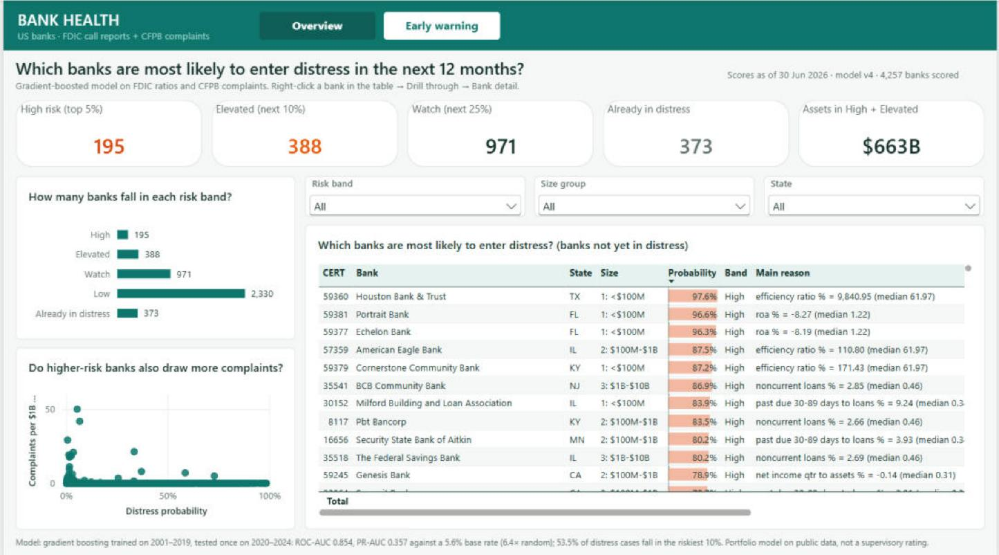
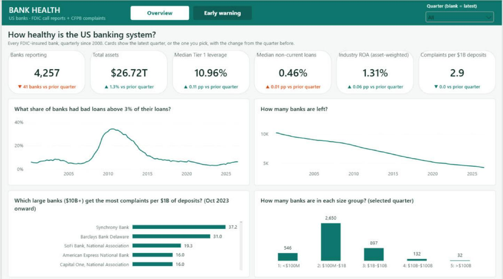
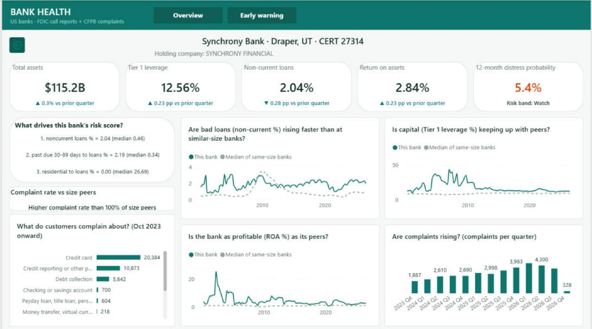

# Bank Health Data Platform

An end-to-end data platform that tracks the health of every FDIC-insured US bank and predicts which
banks are most likely to run into trouble in the next 12 months. It runs on **real public data**:
26 years of FDIC call reports for 27,835 banks and nearly 2 million CFPB consumer complaints.

**Stack:** Apache Airflow · Databricks (PySpark, Delta, Unity Catalog, MLflow) · Snowflake · dbt · Power BI · Docker · pytest

**Project page:** [martinogie.github.io/bank-health-data-platform](https://martinogie.github.io/bank-health-data-platform/)



## What it answers

- How healthy is the US banking system right now, and how has it changed since 2000?
- Which large banks get the most consumer complaints for their size?
- Which banks are most likely to enter distress in the next 12 months, and why?
- For any one bank: are its bad loans, capital and profits keeping up with banks of the same size?

## Architecture

```mermaid
flowchart LR
    A[FDIC BankFind API<br/>financials, institutions, failures] --> AF
    B[CFPB Complaint API<br/>complaints since Oct 2023] --> AF
    AF[Apache Airflow in Docker<br/>weekly DAG, Mondays 06:00 CT] -->|upload raw files| V[(Databricks<br/>Unity Catalog volume)]
    AF -->|run job| DB
    subgraph DB[Databricks, PySpark]
      BR[bronze<br/>raw Delta] --> SI[silver<br/>typed, de-duplicated,<br/>complaint company to FDIC bank] --> GO[gold<br/>one row per bank per quarter]
      GO --> ML[MLflow<br/>train + register model] --> SC[score latest quarter]
    end
    V --> BR
    GO -->|load| SF[(Snowflake RAW)]
    SC -->|load| SF
    SF --> DBT[dbt<br/>staging, intermediate, marts<br/>89 data tests]
    DBT --> M[(Snowflake MARTS)]
    M -->|Import, key-pair login| PBI[Power BI report]
```



Why Airflow downloads the data instead of Databricks: Databricks Free Edition only allows outbound
internet to a short list of trusted domains, so Airflow fetches the files and pushes them into a Unity
Catalog volume.

| Step | Tool | What happens |
|---|---|---|
| Ingest | Airflow + Python (`ingestion/`) | Pages through the FDIC and CFPB APIs. Watermarks mean only new quarters and new complaint dates are fetched after the first run. |
| Bronze / silver / gold | Databricks notebooks (`databricks/notebooks/`) | PySpark turns raw files into Delta tables, removes duplicates, matches complaint companies to FDIC banks and builds about 40 columns of ratios and growth rates per bank-quarter. |
| Model | Databricks + MLflow | Gradient-boosted classifier, tracked and registered in Unity Catalog as `bank_health.ml.distress_model@champion`. |
| Warehouse | Snowflake | `RAW`, `STAGING` and `MARTS` schemas, an XSMALL warehouse that suspends after 60 s, a 20-credit monitor, key-pair service users. |
| Transform + test | dbt (`dbt/`) via astronomer-cosmos | 12 models and 89 data tests, one Airflow task per model. |
| Report | Power BI (`powerbi/`) | Three pages, built from code as a Power BI project (`build_report.py`). |

## Results from the first full run (20 Oct 2026)

| | |
|---|---|
| FDIC history | 106 quarters, 2000 Q1 to 2026 Q2; 743,802 bank-quarters; 4,117 bank failures |
| CFPB complaints | 1,969,948 (1 Oct 2023 to 19 Oct 2026, credit bureaus excluded) |
| Complaints matched to an FDIC bank | 30.0% (591,795) from 142 companies. The rest are mostly debt collectors, fintechs and credit unions, which are not FDIC banks. |
| dbt | 12 models built; 89 tests: 87 passed, 2 warned (real outliers in FDIC data), 0 errors; 5 of 5 freshness checks passed |
| Snowflake cost | about 0.2 credits for the full run |
| Spot checks against the live APIs | JPMorgan Chase total assets Q2 2026, Wells Fargo Q4 2008, complaint counts for Jan 2025 and Jul 2026, failed-bank list: all exact matches |

### Distress model

A bank-quarter is labelled **distressed** if, within the next 4 quarters, the bank fails, loses money two
quarters in a row, has non-current loans above 3%, or has Tier 1 leverage below 5%. Training uses
2001–2019 and the model is tested once on 2020–2024, so it never sees the future.

| Test period 2020–2024 | Gradient boosting (champion v4) | Logistic regression baseline |
|---|---|---|
| ROC-AUC | **0.854** | 0.742 |
| PR-AUC | **0.357** (6.4× the 5.6% base rate) | 0.222 |
| Distress cases caught in the riskiest 10% | **53.5%** | 39.6% |

Scores for 2026 Q2 (4,257 banks): High 195, Elevated 388, Watch 971, Low 2,330, Already in distress 373.
Each bank gets its top three reasons, found by resetting one feature at a time to the median and
measuring how much the probability falls.

> This is a portfolio model on public data. It is not a supervisory rating and should not be used to
> judge any real bank.

## Power BI report

| Overview | Early warning | Bank detail (drill-through) |
|---|---|---|
|  |  |  |

- **Overview:** six KPI cards with the change from the previous quarter, the share of banks with bad
  loans above 3% since 2000, the number of banks left, complaint rates for large banks, banks by size.
- **Early warning:** counts by risk band, a sortable table of every bank's probability and reasons,
  risk versus complaints.
- **Bank detail:** right-click any bank → Drill through. The bank's ratios against the median of banks
  the same size, the reasons behind its score, and what customers complain about.

Design: white page with a teal top bar and page tabs, flat white cards, question-style titles, teal
for good news and orange for bad news on the change lines.

The report is stored as a Power BI project (`.pbip`, TMDL model + PBIR pages), so every measure and
visual is readable text in git. `powerbi/build_report.py` generates the whole thing (model, 60+ DAX
measures, relationships, theme and the three pages), so the report can be rebuilt from code. Power BI connects to Snowflake
in Import mode as `SVC_POWERBI`, a read-only service user with key-pair login
(`snowflake/powerbi_user.sql`).

## Testing

Five kinds of tests, each in code:

| Type | What it checks | Where | Latest result |
|---|---|---|---|
| **Unit** | One function on its own. HTTP sessions, files and clients are replaced with fakes (`FakeSession`, `monkeypatch`, `tmp_path`), so the tests run offline in seconds and never hit a real API. Covers paging, date windows, watermarks, file naming and retry logic. | `ingestion/tests/` | 76 passed |
| **Integration** | Real pieces together: the live FDIC and CFPB APIs, a Databricks Files API upload and list, Snowflake key-pair login and a small `write_pandas` load. Skipped when credentials are missing. | `tests/integration/` (10 tests) | run on demand with credentials |
| **End-to-end** | The whole pipeline after a DAG run: Airflow run state, Snowflake RAW and MARTS row counts, freshness, and numbers checked against the live sources. | `tests/e2e/` | 17 passed (20 Oct 2026 run) |
| **Data quality** | The data itself: unique and not-null keys, relationships, accepted values, value ranges, source freshness. | dbt tests in `dbt/models/**/_*.yml` (`dbt_utils`, `dbt_expectations`) and checks in the silver notebook | 87 passed, 2 warned, 0 errors |
| **Smoke** | Does it start at all: Airflow containers healthy, the API server answers, the DAG imports with no errors. | `tests/smoke/` | 7 passed |

How to run them:

```bash
pytest                                        # unit tests (offline)
pytest tests/integration -m integration       # needs .env credentials
pytest tests/smoke -m smoke                   # needs the Airflow stack running
pytest tests/e2e -m e2e                       # after a full DAG run
cd dbt && dbt build                           # models + data tests
```

## Run it yourself

1. **Accounts:** Databricks Free Edition, a Snowflake trial and Docker Desktop. Copy `.env.example`
   to `.env` and fill it in. Secrets stay in `.env` and `keys/`, which git ignores.
2. **Snowflake:** run `snowflake/setup.sql` as ACCOUNTADMIN, then attach your public key to
   `SVC_BANK_PIPELINE`.
3. **Databricks:** link this repo as a Git folder and run `00_setup` once.
4. **Airflow:** `cd airflow && docker compose up -d`, open http://localhost:8080, then trigger
   `bank_health_weekly`. The first run loads the full history; later runs only add new data.
5. **Power BI:** run `snowflake/powerbi_user.sql`, open `powerbi/BankHealth.pbip`, sign in with
   **Key pair** as `SVC_POWERBI`, then click Refresh. Details are in `powerbi/DASHBOARD_GUIDE.md`.

## Repository layout

```
airflow/      Docker Compose stack, custom image, DAG bank_health_weekly
ingestion/    FDIC + CFPB clients, Databricks upload, Snowflake load (+ unit tests)
databricks/   notebooks 00_setup to 05_score (PySpark, MLflow)
snowflake/    setup.sql, powerbi_user.sql
dbt/          staging, intermediate and mart models with tests
powerbi/      BankHealth.pbip (TMDL + PBIR), build_report.py, theme, screenshots
tests/        integration, smoke and end-to-end tests
docs/         workflow PDF, end-to-end run report
```

## Data sources

- FDIC BankFind Suite API, public domain: <https://api.fdic.gov/banks/>
- CFPB Consumer Complaint Database, CC0: <https://www.consumerfinance.gov/data-research/consumer-complaints/>

---

Built by **Martins Ogiekpolor** · [github.com/martinogie](https://github.com/martinogie) · Built with
AI-assisted coding; the design, analysis and review are my own. MIT licence.
